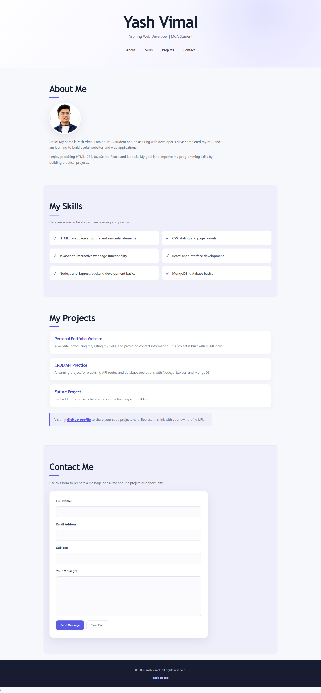

# Week 2: Personal Portfolio with CSS

This folder contains the second version of my personal portfolio. I built on the HTML page from Week 1 and added a separate CSS stylesheet to improve its appearance and make it work well on different screen sizes.

## What I completed

- Kept the portfolio organized with semantic HTML sections for About, Skills, Projects, and Contact.
- Added a coordinated color palette, typography, spacing, and page layout using CSS custom properties.
- Styled the header and navigation, including hover and keyboard-focus states.
- Presented the profile photo as a circular image and the skills as responsive cards.
- Styled project cards, the contact form, buttons, and footer.
- Added responsive layouts for smaller screens and support for reduced-motion preferences.
- Included a screenshot of the portfolio below.

## CSS concepts, design decisions, and responsiveness

The stylesheet is organized by page area, from global styles through the header, page sections, profile image, skills, projects, contact form, footer, and responsive rules. Selectors such as `#skills` and `#contact` apply styles to the matching sections in the HTML.

### CSS concepts used

- **Custom properties:** The `:root` variables define reusable colors, border radius, and shadow values. This keeps the visual theme consistent and makes it easier to adjust.
- **Box sizing and layout:** `box-sizing: border-box` makes element dimensions easier to manage. A centered `main` with a maximum width keeps content readable on wide screens.
- **Flexbox and Grid:** Flexbox centers and wraps the navigation links. CSS Grid displays the skills in two columns on wider screens, with consistent gaps.
- **Fluid sizing:** `clamp()` adjusts headings, section spacing, and form padding within defined limits as the viewport changes.
- **Pseudo-elements:** `::after` adds a decorative accent below section headings, and `::before` adds check marks to the skill cards without changing the HTML.
- **Interactive states:** Hover styles give links, cards, and buttons visual feedback. `:focus-visible` adds a clear keyboard focus outline to links, buttons, and form fields.
- **Transitions:** Short transitions soften color, border, and movement changes on interactive elements.

### Design decisions

The page uses a light background, white surfaces, and lavender-purple accents to create a consistent visual theme. Dark text and muted paragraph text establish a clear reading hierarchy. Rounded corners, subtle borders, and shadows distinguish cards and the contact form from the page background without making the layout feel crowded. The profile image is circular and cropped with `object-fit: cover`.

### Responsive approach

The layout uses a centered, fluid content width so it can shrink on smaller screens. The navigation can wrap when needed. At widths of 700px and below, the skills grid changes from two columns to one, and the header, sections, cards, form, and dividers use smaller spacing. At widths of 420px and below, the base text and navigation spacing are reduced, the profile image becomes smaller, and the contact buttons fill the available width. The reduced-motion media query disables smooth scrolling and minimizes transitions for visitors who prefer less motion.

## Files

- `index.html` — portfolio content and page structure.
- `style.css` — visual design, interactive states, and responsive styles.
- `images/yash.jpeg` — profile image used by the page.
- `screenshots/img.png` — screenshot of the portfolio.

## View the portfolio

Open `index.html` in a web browser. The page loads `style.css` from the same folder. No package installation, build step, or JavaScript is required.

## Contact form note

The form uses a `mailto:` action with a placeholder email address. Replace `your.email@example.com` in `index.html` with the intended address. Submitting the form may open the visitor's email application; it does not send or store messages through a website backend.

## Screenshot

